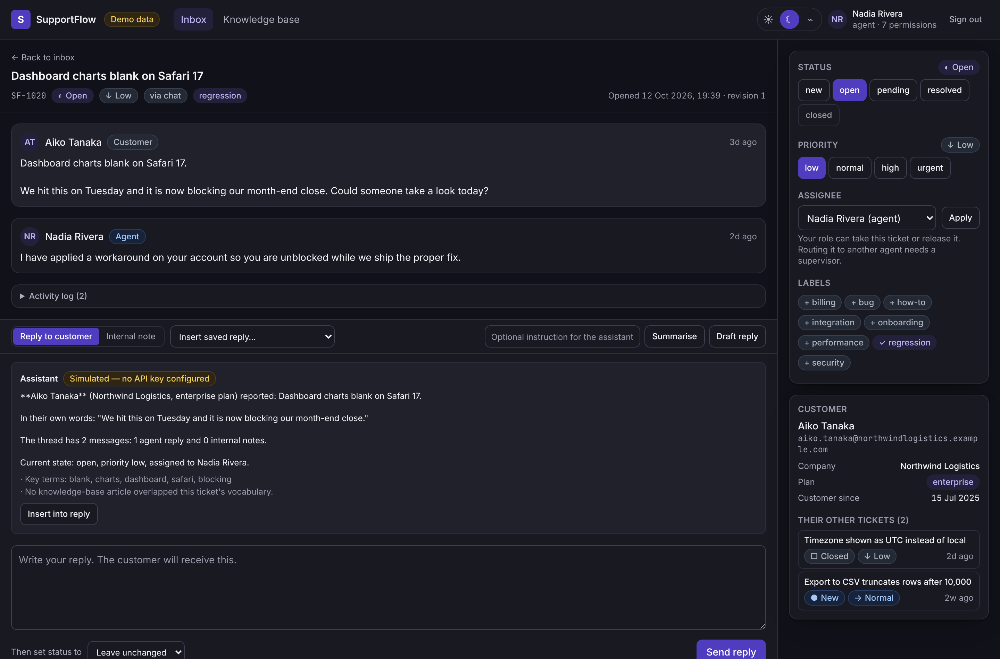
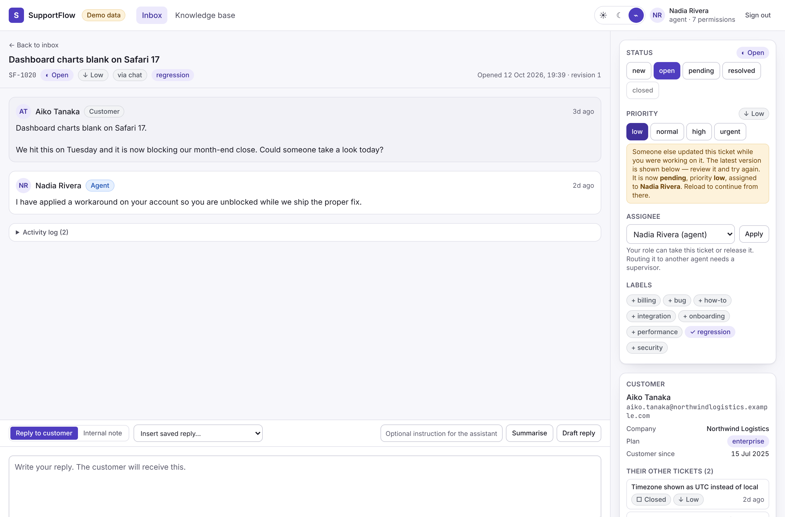
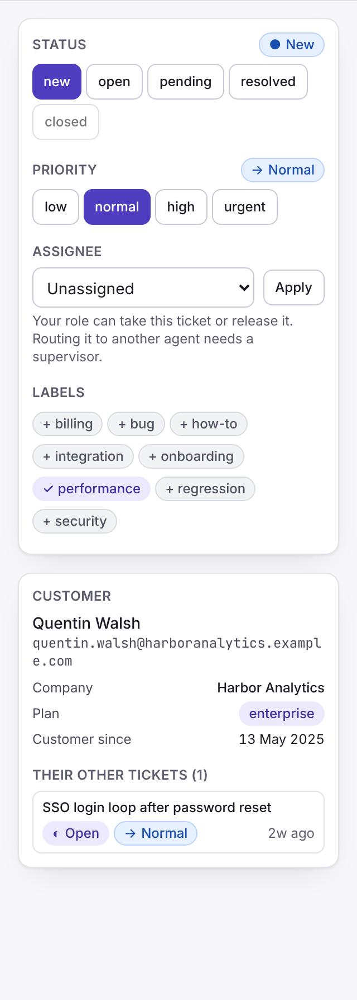
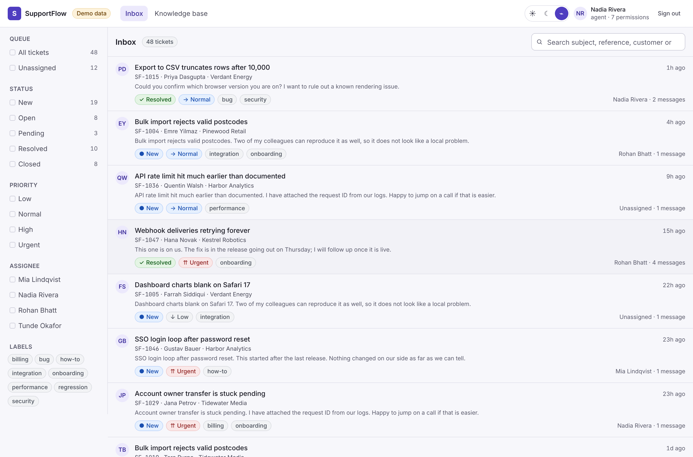
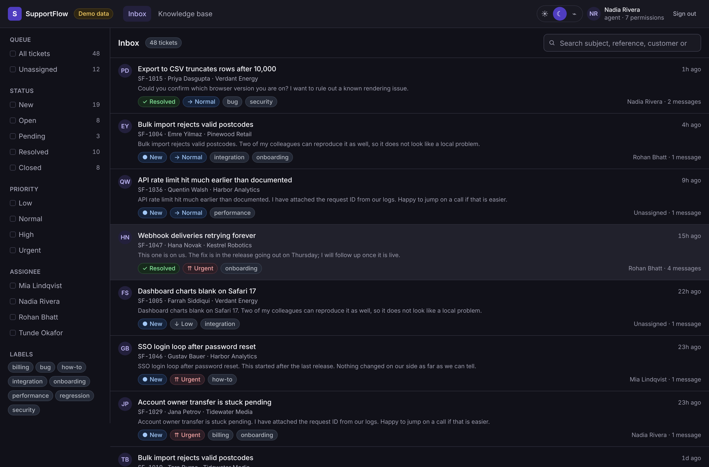
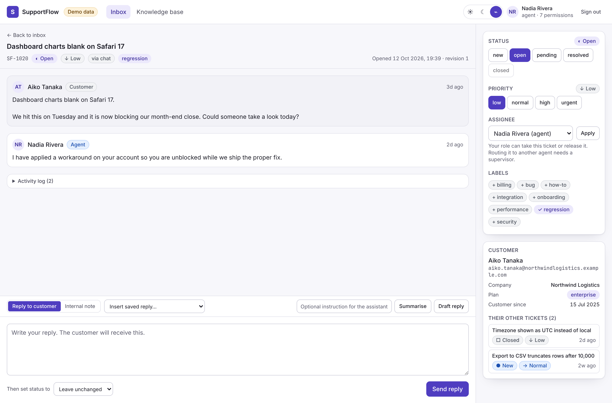
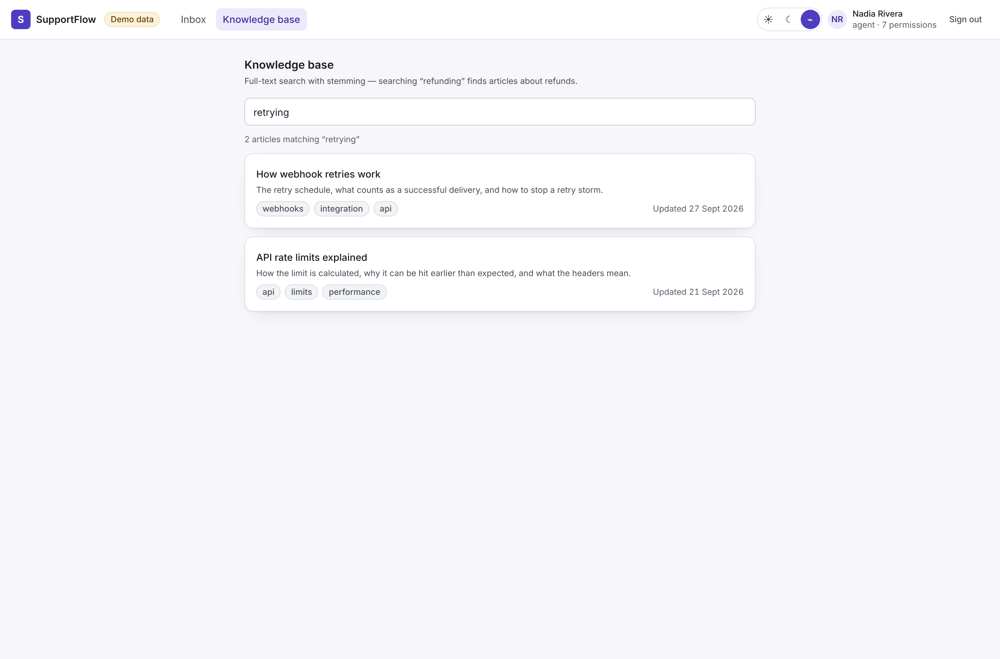
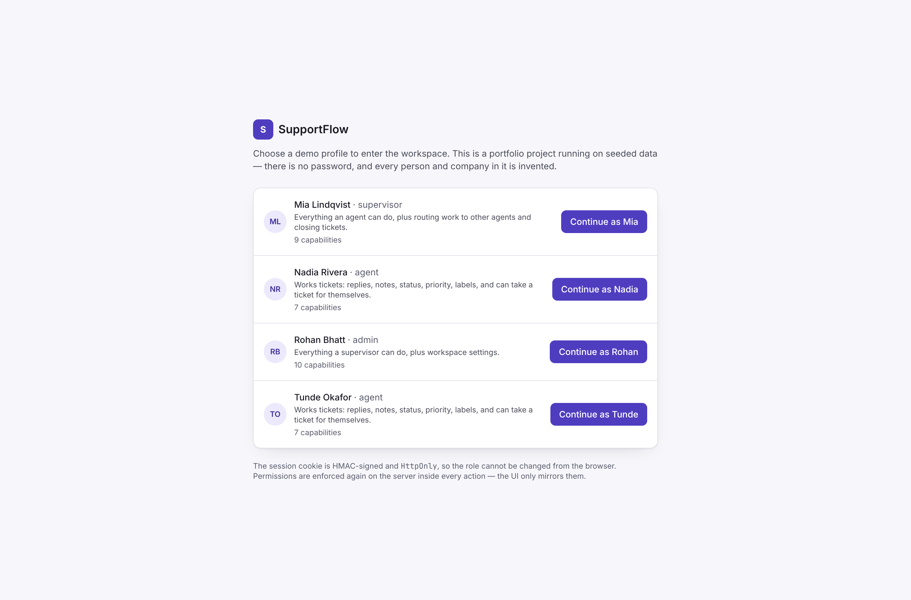
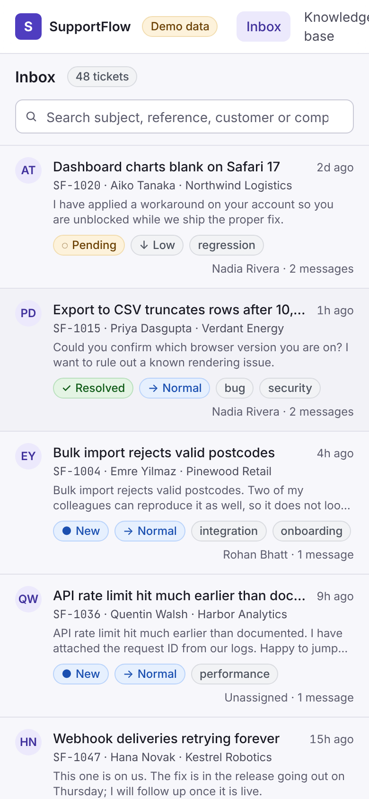

# SupportFlow — customer support & knowledge workspace

A support workspace built with Next.js 16 Server Components, Server Actions
and SQLite. Ticket triage and search, a threaded conversation with internal
notes, **optimistic updates with real rollback**, **optimistic-concurrency
conflict detection**, server-enforced role-based permissions, a stemmed
full-text knowledge base, and an AI assistant that works with no API key.

> **Personal portfolio project.** Built by Shubham Naik in October 2026 as
> independent work — not a client deliverable and not production software for
> any employer. Every person, company, email address and ticket in it is
> invented and generated from a fixed seed.

| | |
|---|---|
| **Live demo** | [supportflow-workspace.vercel.app](https://supportflow-workspace.vercel.app) |
| **Stack** | Next.js 16 (App Router, RSC + Server Actions) · React 19 · TypeScript 5 (strict+) · Tailwind CSS 4 · Zod 4 · SQLite via `node:sqlite` (incl. FTS5) |
| **Tests** | 90 unit / integration (Vitest) + 37 end-to-end (Playwright), including 9 automated axe-core accessibility scans |
| **Quality gates** | `tsc --noEmit` · ESLint 9 flat config · Vitest · Playwright · `next build` — all green, all run in CI |



---

## Why this project exists

It is deliberately the architectural **opposite** of my other portfolio
project, [PulseBoard](../pulseboard-analytics), which is a client-side
dashboard built on TanStack Query and JSON route handlers. Building both the
same way would have demonstrated one skill twice.

| | PulseBoard | SupportFlow |
|---|---|---|
| Reads | Client fetch + TanStack Query cache | Server Components reading SQLite in-process |
| Writes | None (read-only analytics) | Server Actions, Zod-validated, permission-checked |
| State | URL → query string → JSON API | URL for filters; server owns everything else |
| Client JS | The whole dashboard | Two islands: property controls and the composer |
| Hard problem | Period-over-period correctness, chart accessibility | Concurrent edits, authorization, optimistic rollback |

---

## The four things worth reading the code for

### 1. Optimistic updates where the rollback is real

Clicking a status chip updates it instantly. If the write fails — a permission
denial, or another agent got there first — the badge **snaps back**.

The rollback is not hand-written error handling. The optimistic value is
derived from the `ticket` prop via `useOptimistic`, so when the action settles
without that prop having changed, React discards the optimistic value by
itself. Holding it in `useState` would have meant writing (and getting wrong)
an undo path for every mutation.

`src/components/ticket/ticket-controls.tsx`

### 2. Lost updates are detected, not silently applied

Every ticket carries a `version`. Every write is conditional on the version the
client rendered:

```sql
UPDATE tickets
   SET status = ?, updated_at = ?, version = version + 1
 WHERE id = ? AND version = ?
```

`changes === 0` means someone else got there first. The repository re-reads the
row and returns the **actual current state**, so the UI can say "it is now
*pending*, priority *high*, assigned to Mia" rather than "something went
wrong".

Replies are the sharp case: the message insert and the status transition are
separate statements wrapped in one transaction, so a rejected reply does not
leave a message recorded against a ticket whose status never moved. That is
asserted directly in `tests/integration/mutations.test.ts`.



`src/server/repo/mutations.ts` · [ADR 0002](docs/adr/0002-optimistic-concurrency.md)

### 3. Permissions are enforced on the server, and the UI only mirrors them

Server Actions are public HTTP endpoints. A disabled button is a convenience,
not a control.

Every mutating action begins with `requireCapability(...)`, which re-derives
the actor from the signed cookie and checks a named capability —
`ticket:close`, `ticket:assign_others` — against a declarative table. The same
table drives which controls the UI renders as disabled, so the two cannot
disagree.

The session cookie is HMAC-signed and verified with a constant-time
comparison, and the **role is re-read from the database** rather than trusted
from the cookie: a signature proves the payload was not edited, not that the
role is still current. The e2e suite includes a forged-cookie test.



`src/server/auth/` · [ADR 0003](docs/adr/0003-rsc-and-server-actions.md)

### 4. An AI feature that is useful without a key, and honest about it

The app depends on an `AiProvider` interface, never on a vendor SDK. Two
implementations:

- **`MockAiProvider`** — the default. Not a stub: it extracts keywords from the
  customer's own wording, ranks knowledge-base articles by term overlap, counts
  the exchange, and composes a summary or a draft reply from real ticket facts.
  Deterministic, so its output is asserted in tests.
- **`AnthropicAiProvider`** — used only when `ANTHROPIC_API_KEY` is set. The key
  is read inside a Server Action and never reaches the browser. It has a
  timeout, and never echoes the provider's raw error body back to the user.

Every response is labelled with the provider that produced it. Simulated output
says **"Simulated — no API key configured"** on screen. Passing templated text
off as a model response would be the dishonest version of this feature.

`src/server/ai/`

---

## Screenshots

| Inbox (light) | Inbox (dark) |
|---|---|
|  |  |

| Ticket detail | Knowledge base |
|---|---|
|  |  |

| Demo sign-in | Mobile |
|---|---|
|  |  |

---

## What is implemented

Everything here works in the running app and is covered by a test.

**Tickets**

- Inbox over 48 seeded tickets: filter by status, priority, assignee,
  unassigned queue and labels; search subject, reference, customer and company;
  paginate. Every filter is a link, so each view has a real URL and the inbox
  works before hydration.
- Ticket detail: threaded conversation, internal notes clearly marked as not
  sent to the customer, full activity log, customer context and that
  customer's other tickets.
- Status, priority, assignment and labels — each optimistic, each
  permission-gated, each writing an audit entry.
- Reply composer with saved replies inserted at the caret, public/internal
  toggle, and an optional status transition applied in the same transaction.
- Form validation at the server boundary with inline, announced errors.

**Platform**

- Signed `HttpOnly` session cookie; demo sign-in as agent, supervisor or admin.
- Capability-based RBAC enforced in every action and mirrored in the UI.
- Optimistic concurrency on every write; conflicts surfaced with the real
  current state.
- SQLite with foreign keys, `CHECK` constraints, indexes, transactions, and an
  FTS5 index with porter stemming for the knowledge base.
- Light / dark / system theming with no flash on first paint.
- Route-level error and not-found boundaries.

---

## Architecture

```
Browser                                Server
┌────────────────────────┐            ┌──────────────────────────────────┐
│ Links + GET forms      │ ─ GET ───▶ │ Server Component                 │
│  (filters, search)     │            │  parseInboxQuery()  (Zod)        │
│                        │            │  listTickets()  ── SQL ──▶ SQLite│
│ HTML, no client JS     │ ◀── HTML ─ │                                  │
├────────────────────────┤            ├──────────────────────────────────┤
│ Client islands         │ ─ POST ──▶ │ Server Action                    │
│  useOptimistic         │            │  1 requireCapability()  ← cookie │
│  useActionState        │            │  2 Zod parse                     │
│                        │            │  3 repo write WHERE version = ?  │
│ rollback on failure    │ ◀─ state ─ │  4 ActionState + revalidatePath  │
└────────────────────────┘            └──────────────────────────────────┘
```

Layering, strictly one direction:

- `src/server/db/` — schema and deterministic seed. The only module that knows
  SQLite exists, besides the repositories.
- `src/server/repo/` — all SQL. Pure functions over a `DatabaseSync` handle,
  which is what lets every test run against its own isolated database.
- `src/server/auth/` — session (crypto) and capabilities (a table).
- `src/server/ai/` — provider interface plus two implementations.
- `src/server/actions/` — Zod schemas, the four-step action pattern, nothing
  else.
- `src/components/` — presentation. Two client islands; everything else is a
  Server Component.

### Project structure

```
src/
├── app/
│   ├── (workspace)/            routes requiring a session
│   │   ├── inbox/page.tsx
│   │   ├── tickets/[id]/page.tsx
│   │   ├── kb/page.tsx  kb/[slug]/page.tsx
│   │   └── layout.tsx          redirects to /sign-in when signed out
│   ├── sign-in/page.tsx        demo role picker
│   ├── layout.tsx  error.tsx  not-found.tsx
│   └── globals.css             design tokens (the only colour source)
├── components/
│   ├── ui/                     primitives, status badges
│   ├── inbox/                  filter rail, ticket list, search form
│   ├── ticket/                 controls (client), composer (client), thread
│   ├── workspace-shell.tsx  theme.tsx
├── server/
│   ├── db/           schema.sql, seed.ts, connection
│   ├── repo/         tickets.ts, mutations.ts, knowledge.ts
│   ├── auth/         session.ts, roles.ts, current-user.ts
│   ├── ai/           provider.ts, mock.ts, anthropic.ts, index.ts
│   └── actions/      schemas.ts, result.ts, tickets.ts, session.ts
├── lib/              filters, formatting, cn, request-scoped now
└── types/domain.ts
tests/
├── unit/         session, roles, filters, schemas, formatting, AI, action contract
├── integration/  repositories and mutations against real SQLite
├── components/   React Testing Library
└── e2e/          Playwright: journeys + axe-core accessibility
docs/adr/         architecture decision records
```

### Architecture decisions

- [ADR 0001 — SQLite through `node:sqlite`, not an ORM](docs/adr/0001-sqlite-via-node.md)
- [ADR 0002 — Optimistic concurrency with a revision token](docs/adr/0002-optimistic-concurrency.md)
- [ADR 0003 — Server Components and Server Actions](docs/adr/0003-rsc-and-server-actions.md)
- [ADR 0004 — Dependency budget](docs/adr/0004-dependency-budget.md)
- [ADR 0005 — Self-hosted fonts](docs/adr/0005-self-hosted-fonts.md)

---

## Getting started

Requires **Node.js 22.12+** (`node:sqlite` and Vitest 5 both need it).

```bash
git clone <repository-url>
cd supportflow-workspace
npm ci
npm run dev          # http://localhost:3000
```

No environment variables, no database to provision, no API key. Sign in as any
of the four demo profiles to see how the same screens behave at each permission
level.

### Scripts

| Command | What it does |
|---|---|
| `npm run dev` | Dev server (Turbopack) |
| `npm run build` / `npm start` | Production build / serve it |
| `npm run typecheck` | `next typegen` + `tsc --noEmit` |
| `npm run lint` | ESLint 9 flat config |
| `npm run test` | Vitest: unit, integration, component |
| `npm run test:e2e` | Playwright (builds and serves automatically) |
| `npm run verify` | typecheck → lint → test → build, in order |

### Configuration

Every variable is optional; see [`.env.example`](.env.example).

| Variable | Effect when unset |
|---|---|
| `SUPPORTFLOW_DB_FILE` | Database is in memory and re-seeded on every start |
| `SESSION_SECRET` | Falls back to a development secret, warns once in production |
| `ANTHROPIC_API_KEY` | The deterministic offline provider is used and labelled as simulated |
| `AI_PROVIDER=mock` | Forces the offline provider even when a key exists |

---

## Testing

| Layer | Tool | What it proves |
|---|---|---|
| Session | Vitest | Forged payload, forged signature, malformed token, unknown role, expired and future-dated tokens are all rejected; the role is read from the database, not the cookie |
| Permissions | Vitest | Each role's capability set, and that the roles are strictly cumulative |
| Filters & schemas | Vitest | Vocabulary enforcement, de-duplication, canonical URL round-trip, and that an unchecked `"off"` flag parses (the bug that broke every public reply) |
| Repositories | Vitest + real SQLite | Filtering, AND/OR semantics, `LIKE` wildcard escaping, severity-ordered priority sort, pagination without overlap, FTS stemming, and FTS operators in user input degrading to "no results" rather than a 500 |
| Mutations | Vitest + real SQLite | Revision bumps, conflict detection, **no partial write on a rejected reply**, audit entries, and same-millisecond event ordering |
| Action contract | Vitest | Every export of every `"use server"` module is an `AsyncFunction` |
| AI | Vitest | Keyword extraction, article ranking, determinism, graceful degradation on an empty ticket, and provider selection including the forced-mock path |
| Journeys | Playwright | Sign-in/out, forged cookie rejection, filtering, search, pagination, replies, internal notes, the conflict path across two tabs, AI summarise and draft, KB stemming, theme persistence, 404s |
| Accessibility | Playwright + axe-core | WCAG 2.1 A/AA across sign-in, inbox, KB, an article, the ticket detail with the composer, and the AI panel with output — in **both themes** |
| Security | Playwright | A reply containing `` and `<script>` renders as visible text and executes nothing |

### Verified results

Last run on this codebase, Node 22.22.0, Linux:

```
$ npm run typecheck      (clean — no output)
$ npm run lint           (clean — 0 errors, 0 warnings)
$ npm run test           Test Files  11 passed (11)
                              Tests  90 passed (90)
$ npm run test:e2e       37 passed (54.9s)
$ npm run build          ✓ Compiled successfully · 7/7 pages
```

### Four real defects these tests found

1. **Every public reply was silently rejected.** The `internal` flag schema
   accepted `"on" | "true" | "false"` — but an unchecked flag sends `"off"`, so
   validation failed and the user saw "your reply was not sent". Found by e2e;
   now parsed permissively and interpreted strictly, with a unit test.
2. **A `"use server"` module exported a plain object.** It type-checked, built,
   and then arrived as `undefined` in the client component, throwing a
   `TypeError` on first render. Found by e2e; there is now a test asserting
   every action export is an `AsyncFunction`.
3. **The activity log could show events out of order.** Events were ordered by
   `created_at, id` — and `id` is a UUID, so a reply and the status change it
   triggered (same transaction, same millisecond) were ordered at random.
   Surfaced as an intermittently failing integration test; now ordered by
   `rowid`, which is insertion order.
4. **Contrast failures in both themes.** Caught by the axe-core pass before any
   of it shipped; status chips use explicit background/foreground/border
   triplets rather than alpha tints for exactly this reason.

### Running them yourself

```bash
npm run test
npm run test:e2e:install     # once, downloads Chromium
npm run test:e2e
```

On a sandboxed runner without browser downloads:
`PLAYWRIGHT_CHROMIUM_PATH=/path/to/chrome npm run test:e2e`.

---

## Accessibility

- Automated WCAG 2.1 A/AA scans over every route in both themes, including the
  ticket detail with the composer and the AI panel with output — currently
  **zero violations**.
- Skip link as the first tab stop; one `<h1>` and one labelled `<main>` per page.
- Status and priority are always glyph + label + colour, never colour alone.
- Chips use explicit colour triplets verified at ≥ 4.5:1 in both themes.
- Every form control has a programmatically associated label; errors use
  `role="alert"` and `aria-invalid`.
- Success and failure messages are announced (`role="status"` / `role="alert"`),
  so a mutation's outcome is not conveyed by colour or position alone.
- Filters are real links, so they work with the keyboard, with middle-click,
  and before JavaScript loads.
- One centralised visible focus ring; `prefers-reduced-motion` respected.
- Locale and time zone are pinned in every formatter, so server and client
  markup agree.

---

## Security notes

What is genuinely done here:

- **Signed sessions.** HMAC-SHA256, constant-time verification, `HttpOnly`,
  `SameSite=Lax`, `Secure` in production, 8-hour expiry.
- **Role re-read from the database**, never trusted from the cookie.
- **Server-side authorization on every mutation**, independent of the UI.
- **Every input validated with Zod** at the action boundary, including ticket
  ID shape and label character set.
- **Parameterised SQL everywhere**, with `LIKE` wildcards escaped and user
  input escaped into a quoted AND expression before it reaches FTS5.
- **No markup injection.** Message bodies render as plain text;
  `dangerouslySetInnerHTML` is used only for two developer-authored constants
  (the theme bootstrap script and the generated token stylesheet), never for
  user input. Covered by an e2e test.
- **Secrets stay server-side.** No API key, session secret or database path is
  exposed to the client bundle; `.env*` is git-ignored apart from the template.

What is **not** done, and should not be mistaken for done:

- There is no real authentication. The sign-in screen is a labelled demo role
  picker: no password, no identity provider, no account recovery. Replacing it
  means replacing `src/server/auth/session.ts`; the capability checks are
  independent of how identity is established.
- There is no CSRF token beyond `SameSite=Lax` and Next.js's own Server Action
  origin checks.
- There is no rate limiting, audit export, or data-retention policy.

---

## Deployment

**Not currently deployed.** No hosting credentials are configured in this
repository and no deployment has been performed or verified, so no live URL is
claimed.

The app has no external service dependency, so deploying it is just:

```bash
npm ci && npm run build && npm start
```

Two things to know before putting it somewhere:

- **Set `SESSION_SECRET`.** Without it the app uses a well-known development
  secret and says so in the log.
- **SQLite needs a filesystem.** On a long-running Node host (a VM, a
  container, Fly.io, Railway) set `SUPPORTFLOW_DB_FILE` to a path on a
  persistent volume. On serverless platforms each instance has its own
  ephemeral filesystem, so leave it unset — the in-memory database is re-seeded
  per instance, which is fine for a demo and wrong for anything real. Moving to
  Postgres means rewriting `src/server/repo/` and nothing above it.

---

## Known limitations

1. **Demo authentication only** — see Security notes above.
2. **`node:sqlite` is an experimental Node API** and prints a warning on start.
   The surface used is small and confined to one module.
3. **SQLite is single-writer**, so this would not scale to a genuinely busy
   multi-agent desk without moving to Postgres.
4. **The live AI path is untested.** `AnthropicAiProvider` is written to the
   documented Messages API but has never been executed against the real
   service, because that needs a paid key this project does not have. The mock
   provider is the tested path and the default. I would rather say that than
   claim coverage I do not have.
5. **No real-time updates.** A conflict is detected on write, not pushed to the
   other agent's screen. Doing it properly needs a transport (SSE or
   WebSockets) that is out of scope here.
6. **No email, attachments, SLA timers or customer-facing portal.** This is the
   agent workspace.
7. **E2E runs on Chromium only**, and serially, because the specs share one
   seeded database.
8. **`npm audit` reports high-severity advisories** from one transitive
   dev-only chain (`eslint-config-next` → `fast-glob` → `micromatch` →
   `braces`). The only available fix is a major downgrade of
   `eslint-config-next`, which would be a larger regression than the risk. No
   runtime dependency is affected.

---

## Attribution

- All application code here is original work written for this project.
- Dependencies are listed in `package.json` and keep their own licences; none
  are vendored or re-licensed.
- Fonts: [Inter](https://rsms.me/inter/) and
  [JetBrains Mono](https://www.jetbrains.com/lp/mono/), SIL Open Font License
  1.1, via [Fontsource](https://fontsource.org/).
- No starter template, paid theme or third-party project source was copied.

## Licence

[MIT](LICENSE) © 2026 Shubham Naik
